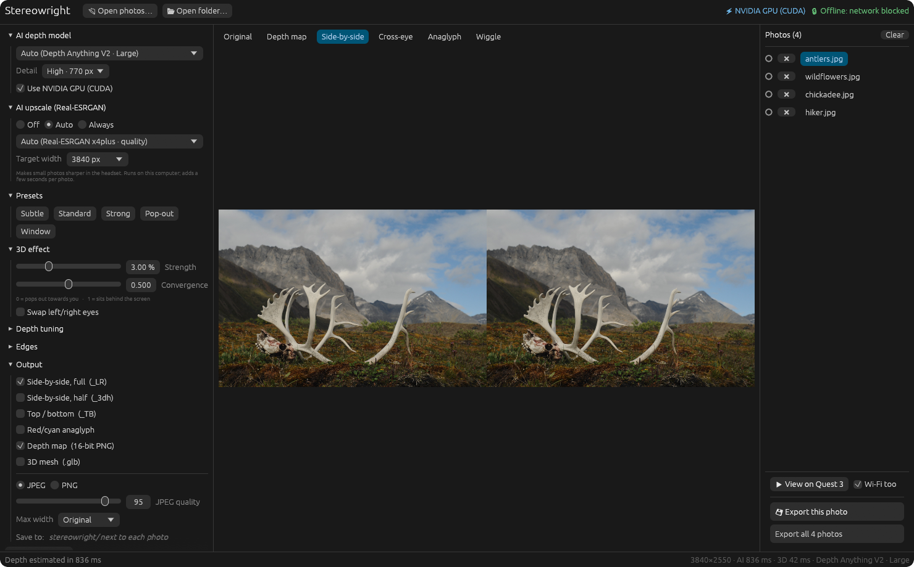
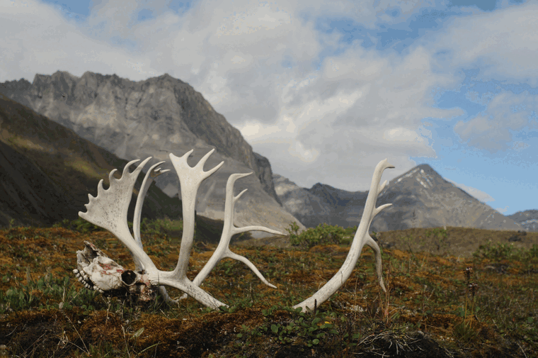
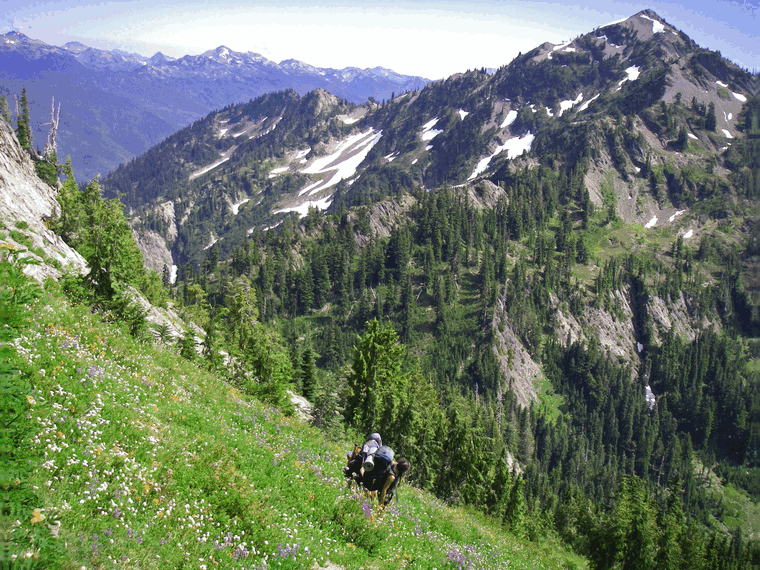
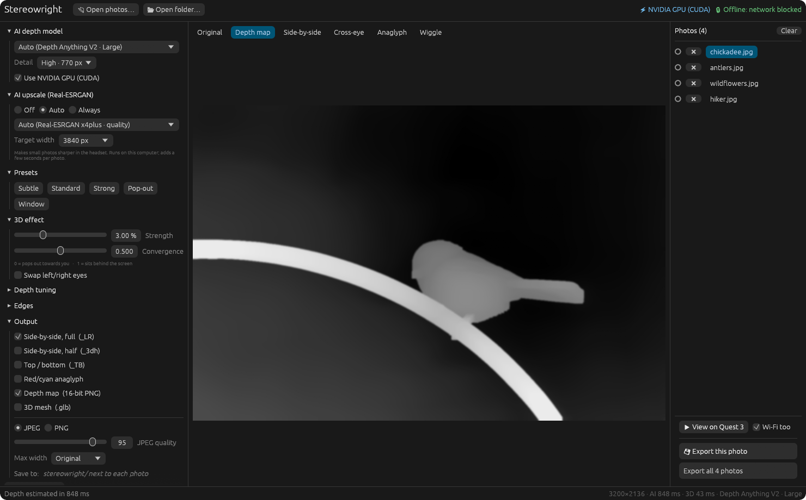
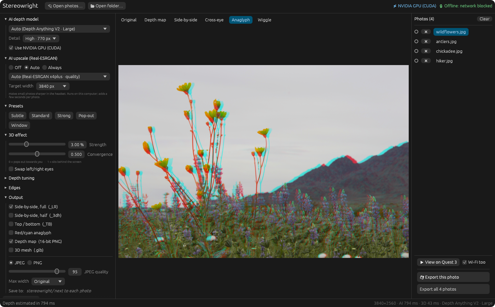
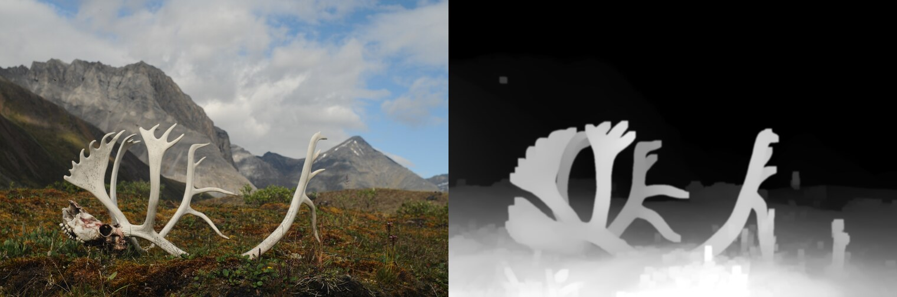

<p align="center">
  
</p>

<h1 align="center">Stereowright</h1>

<p align="center">
  <b>Turn ordinary photos and videos into 3D for your VR headset, using an AI model that runs on your own computer.</b><br>
  Nothing is uploaded. On Linux and macOS, the operating system itself blocks the app from the network.
</p>

<p align="center">
  
</p>

<p align="center">
  
  
  <br>
  <sub>Each eye's view, flicked back and forth. In a headset, this difference between the eyes becomes depth.</sub>
</p>

---

## What it does

Stereowright looks at a normal (2D) photo, works out how far away everything in it is with
the [Depth Anything V2](https://github.com/DepthAnything/Depth-Anything-V2) AI model, then
renders a separate picture for each eye. Open the result in a VR headset, on a 3D TV, or with
red/cyan glasses, and the photo has depth.

- **A desktop app with a live preview.** Drag the sliders and the 3D updates as you go.
  Check the depth on an ordinary monitor with the *Wiggle*, *Cross-eye* or *Anaglyph* views.
- **Every common 3D format:** full and half side-by-side, top/bottom, red/cyan anaglyph,
  a 16-bit depth map, and a textured 3D mesh (`.glb`).
- **Videos too** (from the command line): side-by-side 3D MP4 with the original sound,
  with depth steadied from frame to frame so the 3D doesn't flicker or "breathe".
- **AI upscaling** ([Real-ESRGAN](https://github.com/xinntao/Real-ESRGAN)) for small photos
  that would look soft in a headset.
- **View on a Meta Quest without any cloud service.** An optional helper shows your 3D
  photos in the Quest Browser over the USB cable or your home Wi-Fi.
- **Batch conversion** of whole folders from the command line, with the same settings as the app.
- **Fast on NVIDIA GPUs** (CUDA). It also runs on the CPU, more slowly.

| Depth map view | Anaglyph view |
|---|---|
|  |  |

## What it can and can't do

**It can:**

- Make convincing 3D from almost any photo: people, pets, landscapes, close-ups.
- Run completely offline once it's set up. No account, no upload, no telemetry.
- Convert hundreds of photos in one go, at roughly 2 to 3 seconds per photo on a mid-range NVIDIA GPU.
- Convert videos to side-by-side 3D MP4 (with audio), with steadied depth between frames.
- Save and reuse settings between the app and the command line.

**It can't (or not yet):**

- **See what's hidden.** The AI estimates depth from one picture, so it doesn't know what's
  behind a person or a branch. Where the two eyes need to see "around" an edge, the gap is
  filled from the nearby background. Fine detail against the sky (hair, leaves, fences,
  palm fronds) can show soft or smeared outlines.
- **Get glass, mirrors, water reflections or very unusual scenes right every time.** Depth
  from a single image is a well-informed guess, and these are the cases where it guesses wrong.
- **Give real-world distances.** Depth is relative (near vs far), not in metres. The `.glb`
  mesh is a relief you can lean around a little, not a full 3D model you can walk behind.
- **Convert videos in the app window.** Videos are converted with `stereowright convert`
  for now. Video is also slow: around 2 to 12 frames per second at 1080p depending on
  settings, so a one-minute clip takes a few minutes or more.
- **Handle 360° / VR180 photos, existing stereo pairs, RAW, HEIC or AVIF files.** Supported
  inputs are JPEG, PNG, WebP, TIFF and BMP photos, and MP4, MOV, MKV, WebM, AVI, MTS and
  M2TS videos (videos need `ffmpeg`).
- **Enforce the network block on Windows.** Windows has no way for a program to lock itself
  out of the network, so there the promise rests on the app having no networking code
  (blocking it in Windows Defender Firewall makes it enforced: see the `README.txt` in the
  download). **View on Quest 3** sharing is Linux-only for now, and Intel Macs aren't
  supported.

## Download

Ready-made downloads are on the [Releases page](https://github.com/vwillcox/stereowright/releases).
Each one includes the app, the GPU runtime, the Depth Anything V2 Small model and the
Real-ESRGAN upscalers; Windows and macOS also include ffmpeg for video.

| System | Download | GPU | Network block |
|---|---|---|---|
| Linux x86-64 (glibc 2.39+) | `…-linux-x86_64.tar.gz` | NVIDIA (CUDA 13 + cuDNN 9), else CPU | ✅ kernel seccomp filter |
| macOS 13.4+, Apple silicon | `…-macos-arm64.dmg` | Apple GPU / Neural Engine (Core ML) | ✅ kernel sandbox |
| Windows 10 / 11, 64-bit | `…-windows-x86_64.zip` | any DirectX 12 GPU (DirectML), else CPU | ⚠️ none: use the firewall |

The apps aren't signed with paid certificates. On macOS, the first start is blocked: go to
**System Settings → Privacy & Security** and click **Open Anyway**. On Windows, click
**More info → Run anyway**. Details: [installation guide](docs/INSTALL.md#ready-made-downloads).

## Build from source

On Arch Linux (other distributions: see the [installation guide](docs/INSTALL.md)):

```bash
sudo pacman -S --needed rust cuda cudnn ffmpeg    # cuda/cudnn only for NVIDIA GPUs
git clone https://github.com/vwillcox/stereowright.git
cd stereowright
scripts/fetch-models.sh small large    # one-off model download (~770 MB, SHA-256 checked)
cargo build --release                  # also downloads Rust libraries + ONNX Runtime
./target/release/stereowright doctor   # check the GPU, models and network block
./target/release/stereowright          # open the app
scripts/install.sh                     # optional: add it to your app launcher
```

Then open a photo, pick a preset, and click **Export this photo**. The 3D files go into a
`stereowright/` folder next to the photo.

## Documentation

- **[Installation guide](docs/INSTALL.md):** requirements, GPU set-up, models, the app
  launcher, Quest sharing set-up, updating and uninstalling, troubleshooting.
- **[User guide](docs/USER_GUIDE.md):** the app step by step, every setting explained,
  output formats, viewing on a headset, the command line, videos, and tips for good 3D.

## Privacy: how "nothing leaves your computer" is enforced

1. **No networking code.** No HTTP, TLS or network libraries are compiled into the app.
   `scripts/audit-network.sh` checks the dependency tree and fails if one appears.
2. **A kernel-level block.** The first thing the app does is install a seccomp filter that
   makes the Linux kernel refuse to open internet (IPv4/IPv6), raw or Bluetooth sockets for
   the whole process, including ONNX Runtime, the CUDA libraries and the GUI toolkit. It
   can't be undone once installed, and child processes (such as `ffmpeg`) inherit it. A
   self-test proves it at start-up, and the app shows **Offline: network blocked** in its
   top-right corner.
3. **An optional extra layer.** `scripts/run-offline.sh` (used by the app-launcher entry)
   starts the app inside a private network namespace with no network devices at all.

On **macOS**, step 2 is a kernel sandbox instead: the app's first act is to enter a sandbox
profile that denies every network connection (including to the Mac itself), which the
bundled ffmpeg inherits, and the same self-test checks it. On **Windows** there is no
equivalent, so only step 1 applies, and the app says **No network block on this system**;
the download's `README.txt` gives three PowerShell commands that block it in Windows
Defender Firewall.

The only things that use the network are the ones you run yourself, and they only download:
`scripts/fetch-models.sh` and `scripts/make-upscalers.sh` (both check SHA-256 hashes), and
`cargo build`, which fetches Rust libraries and the ONNX Runtime engine at build time.

**Quest sharing is the one deliberate exception, and it is a separate program.** When you
click **View on Quest 3**, a small helper (`quest/stereowright_share.py`, Python standard
library only) serves your exported 3D photos to your own headset over the USB cable
(localhost only) or your home Wi-Fi (HTTPS, a secret link, private addresses only). It never
connects out to the internet, and the Stereowright app itself stays network-blocked.

## How it works

<p align="center">
  
</p>

1. **Depth:** Depth Anything V2 (an ONNX model run by ONNX Runtime, on the GPU if possible)
   predicts relative depth for every pixel. Brighter means nearer.
2. **Clean-up:** the depth map is normalised, shaped with a curve, smoothed, and near
   objects are grown slightly so that edge artefacts land on the background, not on people.
3. **Two eyes:** each row of the photo is shifted by an amount that depends on depth, once
   for each eye, with near pixels hiding far ones. Gaps that open up at depth edges are
   filled from the background side, then blended with a depth-aware blur.
4. **Export:** the pair is packed as side-by-side, top/bottom or anaglyph; the depth map
   and mesh are written alongside.

Source map: `depth.rs` (AI inference) → `postprocess.rs` → `stereo.rs` → `export.rs`,
tied together by `pipeline.rs` for both the command line (`cli.rs`) and the app (`gui/`).
`sandbox.rs` is the network block, `upscale.rs` the Real-ESRGAN upscaler, `video.rs` and
`temporal.rs` the video path, and `quest.rs` + `quest/` the Quest sharing helper and viewer.

## Models and licences

Stereowright's own code is MIT-licensed (see [LICENSE](LICENSE)). The AI models are
downloaded separately by the scripts and keep their own licences:

| Model | Used for | Size | Licence |
|---|---|---|---|
| Depth Anything V2 Small | depth (fast) | 99 MB | Apache-2.0 |
| Depth Anything V2 Base | depth | 195 MB | CC-BY-NC-4.0 (non-commercial) |
| Depth Anything V2 Large | depth (best detail) | 669 MB | CC-BY-NC-4.0 (non-commercial) |
| Real-ESRGAN x4plus / x2plus / general-x4v3 | upscaling | 5–67 MB each | BSD-3-Clause |

**If you use Stereowright commercially, use only the Small depth model**
(`scripts/fetch-models.sh small`). Base and Large are licensed for non-commercial use only.

Any other ONNX monocular depth model can be added in `models/models.toml`.

## Performance

Measured on an NVIDIA RTX 5060 Ti with the Large model unless noted:

| Task | Time |
|---|---|
| Depth estimate, 518 px detail | ~0.12 s |
| Depth estimate, default 770 px detail | ~0.8 s |
| Whole photo, 3840 px wide, four output files (command line) | 2 to 3 s |
| 1080p video, default settings | ~2 frames/s |
| 1080p video, `--detail 518` | ~6.5 frames/s |
| 1080p video, `--detail 518 --model da2-small` | ~12 frames/s |
| CPU only (no GPU), Small model, one photo | ~4 s |

On an Apple M4 Mac mini (16 GB, Core ML, Small model): about 1.5 to 2 s for the depth
estimate at 518 px (the Mac default), 10 to 20 s at 770 px, and about 1.2 s per frame for
video at 518 px.

## Development

```bash
cargo test --release           # unit tests (stereo maths, gap filling, video steadying, GLB format, …)
cargo clippy --release --all-targets
scripts/audit-network.sh       # prove no network libraries are compiled in
```

Contributions are welcome. Please keep the privacy rules: no network libraries in the app,
no telemetry or update checks, and `sandbox::lock_down()` stays the first call in `main`.

## Credits

- [Depth Anything V2](https://github.com/DepthAnything/Depth-Anything-V2) by Lihe Yang et al.,
  with ONNX exports by [onnx-community](https://huggingface.co/onnx-community).
- [Real-ESRGAN](https://github.com/xinntao/Real-ESRGAN) by Xintao Wang et al.
- [ONNX Runtime](https://onnxruntime.ai/) through the [`ort`](https://github.com/pykeio/ort) crate,
  and [egui/eframe](https://github.com/emilk/egui) for the interface.
- Example photos: public-domain images from the U.S. National Park Service and the U.S. Fish
  and Wildlife Service. See [docs/images/CREDITS.md](docs/images/CREDITS.md).

Meta and Meta Quest are trademarks of Meta Platforms, Inc. Stereowright is an independent
project and is not affiliated with or endorsed by Meta.
