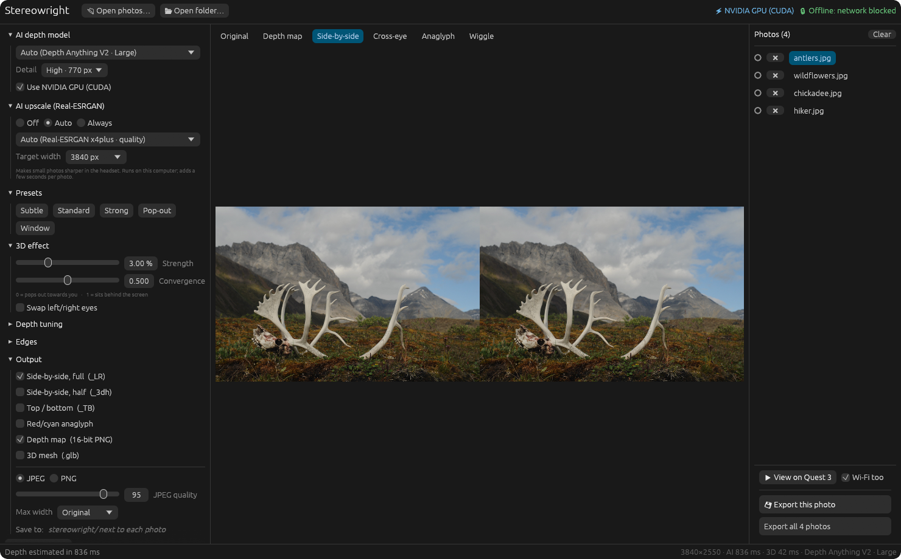

# Stereowright user guide

How to turn photos (and videos) into 3D you can look at in a VR headset, on a 3D TV or with
red/cyan glasses. If you haven't installed Stereowright yet, start with the
[installation guide](INSTALL.md).

- [The idea in one minute](#the-idea-in-one-minute)
- [Your first 3D photo](#your-first-3d-photo)
- [The window](#the-window)
- [Preview views](#preview-views)
- [Settings, one by one](#settings-one-by-one)
- [Exporting and output files](#exporting-and-output-files)
- [Viewing your 3D](#viewing-your-3d)
- [Viewing on a Meta Quest](#viewing-on-a-meta-quest)
- [The command line](#the-command-line)
- [Videos](#videos)
- [Tips for good 3D](#tips-for-good-3d)
- [Fixing common problems](#fixing-common-problems)
- [Where Stereowright keeps things](#where-stereowright-keeps-things)

## The idea in one minute

Your two eyes see the world from slightly different places, and your brain turns the
difference into depth. A normal photo has only one viewpoint, so Stereowright:

1. asks an AI model to estimate **how far away every pixel is** (the *depth map*: white is
   near, black is far);
2. makes **two new pictures**, one per eye, by shifting near things more than far things;
3. saves the pair in a format your headset or TV understands.

Two settings matter most:

- **Strength:** how far apart the two eyes' pictures are, so how deep the 3D feels.
- **Convergence:** which distance sits "at the screen". Things nearer than that come out
  towards you; things farther away sit behind it, as if seen through a window.

## Your first 3D photo

1. Open Stereowright (from your app launcher, or run `stereowright`).
2. Click **📂 Open photos…** (or press **Ctrl+O**), or drag photos or a folder onto the window.
3. The photo appears in the middle as a **Side-by-side** pair. The first time, loading the
   AI model takes a couple of seconds.
4. Click the **Wiggle** tab: the picture flicks between the two eyes. Near things should move
   against the background. That's your 3D.
5. Try the presets (**Subtle**, **Standard**, **Strong**, **Pop-out**, **Window**) and watch the preview.
6. Click **Export this photo** (or press **Ctrl+E**). The files are saved in a `stereowright/`
   folder next to your photo.
7. Copy `yourphoto_LR.jpg` to your headset, or use [Quest sharing](#viewing-on-a-meta-quest).

## The window



- **Top bar:** open photos or a folder. On the right, which processor the AI runs on
  (for example **NVIDIA GPU (CUDA)**) and **Offline: network blocked**, which means the
  kernel network block is active and was verified at start-up.
- **Left panel:** all the settings, in sections you can fold away.
- **Middle:** the preview, with the view tabs along the top.
- **Right panel:** your list of photos. Click one to show it, or use the **arrow keys**;
  **✖** removes a photo from the list (the file stays where it is), and **Clear** empties the
  list. Below the list: Quest sharing and the export buttons.
- **Bottom bar:** what's happening, the photo's size, and how long the AI and the 3D took.

The preview updates live as you move sliders. Most settings only redo the quick 3D step.
Changing the model or **Detail** runs the AI again, which takes a moment.

## Preview views

| View | What it shows | Use it to |
|---|---|---|
| **Original** | The photo as loaded (after any upscaling) | Compare |
| **Depth map** | What the AI estimated: white = near, black = far | Spot depth mistakes |
| **Side-by-side** | Left eye \| right eye, exactly as in the `_LR` file | See what you'll export |
| **Cross-eye** | Right eye \| left eye | See 3D without any equipment: cross your eyes until the two pictures merge into a third one in the middle |
| **Anaglyph** | Red/cyan | See 3D with red/cyan glasses |
| **Wiggle** | Flicks between the two eyes | Judge depth quickly on a normal monitor |

## Settings, one by one

Settings are remembered between sessions. **Settings ▸ Reset to defaults** puts everything back.

### AI depth model

- **Model:** *Auto* picks the best model you have installed (Large, then Base, then Small).
  Small is fastest; Large has the finest detail.
- **Detail:** the resolution the AI works at (shortest side). Higher shows finer edges
  (hair, leaves, branches) but takes longer and needs more GPU memory.

  | Level | Pixels | Notes |
  |---|---|---|
  | Fast | 392 | quick previews |
  | Standard | 518 | the model's native size |
  | **High** (default) | 770 | good balance |
  | Very high | 1022 | fine detail |
  | Ultra | 1274 | finest; needs a lot of GPU memory |

  If the GPU runs out of memory, Stereowright retries at a lower resolution automatically.
- **Use NVIDIA GPU (CUDA):** on by default. Turn it off to force the CPU.

### AI upscale (Real-ESRGAN)

Headsets show a lot of detail, so small photos look soft. The upscaler (if you built it,
see the [installation guide](INSTALL.md#ai-upscaling-real-esrgan)) enlarges photos before
the 3D step.

- **Off / Auto / Always:** *Auto* (default) upscales only photos narrower than two-thirds of
  the target width. *Always* upscales every photo narrower than the target.
- **Model:** *x4plus* (best detail, slowest), *x2plus* (gentle 2×, invents the least),
  *general v3* (very fast, softer).
- **Target width:** 1920, 2560, **3840** (default) or 5120 pixels.

Upscaling adds a few seconds per photo, all on your computer.

### Presets

Presets set Strength, Convergence and Depth curve, and leave everything else alone.

| Preset | Strength | Convergence | Curve | Feels like |
|---|---|---|---|---|
| Subtle | 1.8 % | 0.5 | 1.0 | gentle, comfortable for long viewing |
| **Standard** | 3.0 % | 0.5 | 1.0 | balanced (default) |
| Strong | 5.0 % | 0.45 | 1.15 | deep and dramatic |
| Pop-out | 3.5 % | 0.15 | 1.2 | the subject comes out towards you |
| Window | 3.0 % | 0.95 | 1.0 | everything behind the screen |

### 3D effect

- **Strength** (% of the picture width): the total shift between the nearest and farthest
  point. **2–4 % is comfortable.** Above about 6 % many people get eye strain.
- **Convergence** (0 to 1): *0* puts the farthest point at the screen, so everything pops
  out; *1* puts the nearest point at the screen, so everything sits behind it like a
  window; *0.5* is in between.
- **Swap left/right eyes:** if the 3D looks inside-out (near things look far away) in your
  player, tick this. Some players expect the right eye first.

### Depth tuning

- **Depth curve:** above 1 gives more depth between nearby things (faces, a subject);
  below 1 spreads more depth into the background (landscapes).
- **Background flatten:** everything farther than this is pressed onto one back plane.
  Stops a distant sky or wall taking depth away from the subject.
- **Foreground flatten:** the same for the nearest things.
- **Smoothing:** blurs the depth map. Hides noise and wobbly outlines, but softens detail.
- **Edge grow:** makes near objects slightly bigger in the depth map, so that edge
  artefacts fall on the background instead of on people and objects.
- **Invert depth:** swaps near and far. Rarely needed.

### Edges

When the two eyes look "around" a near object, a sliver of background is revealed that the
photo never showed. You choose how to handle it:

- **Sharp: fill gaps from background** (default): crisp outlines; the gap is filled with
  nearby background texture.
- **Smooth: stretch across edges:** no gaps, but outlines are smeared into the background.
- **Edge sensitivity** (Sharp only): lower values treat more places as hard edges.

### Output

- **Formats:** tick any of side-by-side full (`_LR`), side-by-side half (`_3dh`),
  top/bottom (`_TB`), red/cyan anaglyph, depth map (16-bit PNG) and 3D mesh (`.glb`).
  See [output files](#exporting-and-output-files).
- **JPEG / PNG** and **JPEG quality** (default 95).
- **Max width:** shrink large photos before converting (Original, 7680, 5760, 3840, 2560 or
  1920 px). Full side-by-side doubles the width, so a 3840 px photo becomes a 7680 px file.
- **Save to:** *next to each photo* (a `stereowright/` folder beside the original), or a
  folder you choose.

### Settings

**Save as…** writes the current settings to a `.toml` file and **Load…** reads one back.
The same file works on the command line with `stereowright convert --settings file.toml`.

## Exporting and output files

- **Export this photo** (Ctrl+E) converts the selected photo at full resolution.
- **Export all N photos** converts the whole list with the current settings.
- After an export, **📂 Open output folder** opens the folder the files went to.

For a photo called `beach.jpg` you get:

| File | What it is | Use it for |
|---|---|---|
| `beach_LR.jpg` | Full side-by-side: left eye on the left, each eye at full size | **VR headsets** (best quality) |
| `beach_3dh.jpg` | Half side-by-side: both eyes squeezed into the original width | 3D TVs and players that expect half-SBS |
| `beach_TB.jpg` | Top/bottom: left eye on top | Players that prefer over/under |
| `beach_anaglyph.jpg` | Red/cyan | Any screen with cheap 3D glasses |
| `beach_depth.png` | 16-bit depth map, white = near | Blender, ComfyUI, other 3D tools |
| `beach_mesh.glb` | Textured 3D surface | 3D model viewers; a little real head-movement parallax |

The `_LR`, `_3dh` and `_TB` suffixes are the ones most VR players use to recognise the
format automatically. Stereowright skips files with these suffixes when you convert a
folder again, so it never converts its own output.

## Viewing your 3D

**VR headsets.** Use the `_LR` file. Any VR photo viewer that supports side-by-side 3D
works: copy the file to the headset (for a Quest: plug it in, allow file access in the
headset, and copy into `Pictures`), then open it in the viewer and choose *SBS* or
*3D side-by-side* if it doesn't detect it. Or use Stereowright's own
[Quest sharing](#viewing-on-a-meta-quest), which needs no app and no copying.

**3D TVs and projectors.** Use the `_3dh` (half side-by-side) or `_TB` file and set the TV's
3D mode to match.

**Red/cyan glasses.** Use the `_anaglyph` file on any screen. Red goes over the left eye.

**No equipment.** The **Cross-eye** view in the app, or the **Wiggle** view.

**Other 3D software.** The depth PNG drops into Blender (as a displacement map), ComfyUI and
similar tools. The `.glb` mesh opens in most 3D model viewers.

Some players expect the right eye first. If the depth looks inside-out, tick **Swap
left/right eyes** and export again.

## Viewing on a Meta Quest

Stereowright can show your 3D photos in a 3D gallery in the **Quest Browser**, with no app
to install and no cloud service. New exports appear in the headset by themselves, so the
loop is: tweak → Export → look.

Click **▶ View on Quest 3** at the bottom right of the app (or run `stereowright quest start`).
This starts the *Quest sharing helper*, a separate small program that runs in the
background as a systemd user service. **Wi-Fi too** is ticked by default; untick it first
if you only want to use the cable.

**Over the USB cable** (no network involved at all):

1. Once: turn on developer mode and allow USB debugging (see the
   [installation guide](INSTALL.md#viewing-on-a-meta-quest)).
2. Plug the headset in. The gallery opens in the headset's browser by itself.

**Over your home Wi-Fi:**

1. Click **📱 Show QR code**. In the headset open the QR code scanner (Quick settings ▸
   QR code scanner, or say "Hey Meta, open QR code scanner"), look at the code and open the
   link. Or type in the **Wi-Fi link** shown in the app.
2. First time only: accept the security warning. The connection is encrypted with a
   certificate made on your computer, which the browser doesn't know yet. Then **bookmark**
   the page so you never need the code again.
3. If the app says the firewall blocks the headset, copy the command it shows into a
   terminal once.

**In the gallery**, tap a photo or **View in 3D**. *Jump to new photos* shows each new
export as soon as it's ready. *See my room* shows the photo floating in your room
(passthrough) instead of a dark space.

**In 3D:**

| Control | Does |
|---|---|
| Trigger or pinch | next photo (left hand: previous) |
| Thumbstick left / right | previous / next |
| Thumbstick up / down | bigger / smaller |
| Thumbstick press | normal size |
| Grip | bring the photo in front of you |
| A / X | show the photo's name |
| B / Y | back to the gallery |

**Stop sharing** with **Stop** in the app, or `stereowright quest stop`. Check it with
`stereowright quest status`; the log is in `journalctl --user -u stereowright-quest-share`.

What the helper does and doesn't do:

- It shows only the `_LR`, `_3dh` and `_TB` files from your Stereowright output folders,
  read-only. It can't see any other file.
- **USB** mode listens on `127.0.0.1` only; the headset reaches it through the cable.
- **Wi-Fi** mode listens on your home network address only, refuses anything that isn't a
  private (home network) address, needs the secret token in the link, and uses HTTPS.
- It never connects out to anything. The 3D viewer is a few local files, with nothing
  loaded from the internet.

## The command line

Everything the app does can be done in a terminal, which is handy for whole folders.

```text
stereowright [PHOTOS…]          open the app (optionally with photos, videos or folders)
stereowright convert <inputs…>  convert photos, videos or folders without opening the app
stereowright models             list depth models and upscalers, and whether they're installed
stereowright doctor             check the GPU, models and network block
stereowright settings           print the default settings as a .toml file
stereowright quest start [--usb-only] | status | stop
```

Examples:

```bash
stereowright convert ~/Pictures/trip                     # a whole folder, default settings
stereowright convert a.jpg b.jpg --preset strong --formats sbs,anaglyph
stereowright convert pics/ --strength 4 --convergence 0.7 --detail 1022 --out ~/VR
stereowright convert pics/ --settings my-settings.toml   # settings saved from the app
stereowright convert small/ --upscale always --upscale-model esrgan-general-x4v3
stereowright settings > my-settings.toml                 # a template to edit
```

`convert` options (run `stereowright convert --help` for the full list):

| Option | Meaning |
|---|---|
| `-o, --out <folder>` | where to save (default: `stereowright/` next to each input) |
| `--settings <file.toml>` | start from saved settings; other options override it |
| `--preset subtle\|standard\|strong\|popout\|window` | a preset |
| `--model <id>` | `da2-small`, `da2-base` or `da2-large` (default: best installed) |
| `--cpu` | don't use the GPU |
| `--strength <percent>` | 3D strength, e.g. `3` |
| `--convergence <0..1>` | 0 = pops out, 1 = behind the screen |
| `--detail <px>` | 392, 518, 770, 1022 or 1274 |
| `--curve`, `--smoothing`, `--dilation` | depth curve, smoothing (%), edge grow |
| `--invert`, `--swap-eyes` | flip near/far, swap the eyes |
| `--edge-mode fill\|stretch` | Sharp or Smooth edges |
| `--formats sbs,hsbs,tb,anaglyph,depth,glb` | which files to write |
| `--quality <1-100>`, `--png` | JPEG quality, or PNG instead |
| `--max-width <px>` | shrink inputs wider than this |
| `--upscale off\|auto\|always`, `--upscale-model <id>`, `--upscale-width <px>` | AI upscaling |
| `--video-width`, `--steady`, `--video-quality` | video options, see below |

Folders are read one level deep (not subfolders). The command exits with an error if any
file failed, after converting the rest.

## Videos

Videos are converted from the command line (the app window handles photos only, for now):

```bash
stereowright convert holiday.mp4
stereowright convert clips/ --video-width 1280 --detail 518    # faster
```

- **Output:** `holiday_LR.mp4` (side-by-side) by default. `--formats` also offers `hsbs`, `tb`,
  `anaglyph` and `depth` (a greyscale depth video). The `.glb` mesh isn't available for video.
- **Sound** is kept from the original.
- **Size:** each eye is at most 1920 px wide by default (`--video-width`, 0 = original size),
  so a 4K clip becomes a 3840×1080 side-by-side video. That plays smoothly on most headsets.
- **Steady depth:** the AI looks at each frame separately, which can make the 3D flicker or
  "breathe". `--steady` (0 = off to 1 = strongest, default 0.5) smooths depth over time
  where the picture is still, and lets it change straight away where things move.
  Scene cuts are detected and start afresh.
- **Quality:** `--video-quality` (lower = better and bigger, default 20; 18–24 is sensible).
  The NVIDIA hardware encoder is used when available.
- **HDR** phone videos are converted to normal range.
- **Speed:** on an RTX 5060 Ti at 1080p, about 2 frames per second with the Large model at
  the default detail, 6.5 with `--detail 518`, and 12 with `--detail 518 --model da2-small`.
  A one-minute 30 fps clip therefore takes from about 3 to 15 minutes.

Supported inputs: MP4, M4V, MOV, MKV, WebM, AVI, MTS and M2TS (anything your `ffmpeg` can decode).

## Tips for good 3D

- **Photos with clear layers work best:** a subject in front of a background, a path
  leading into a landscape, branches in front of the sky.
- **Start with Standard,** check in the headset, then adjust. Small changes go a long way.
- **Comfort first:** if your eyes feel strained, lower Strength or raise Convergence. Things
  that pop out a long way are the hardest to look at.
- **Flat-looking landscapes:** set Depth curve below 1, or use Background flatten to stop
  the sky taking all the depth.
- **Portraits:** set Depth curve a little above 1 for more depth in the face; Pop-out
  brings the person towards you.
- **Fuzzy halos around hair or leaves:** raise Detail (the AI sees finer edges), raise Edge
  grow a little, or try **Smooth** edges.
- **Small or old photos:** turn on AI upscale so they stay sharp in the headset.
- **Phone photos** are turned the right way up automatically (EXIF orientation).

## Fixing common problems

**The 3D looks inside-out.** Tick **Swap left/right eyes** (your player expects the right eye first).

**Part of the scene has the wrong depth** (a reflection, a window, a painting on a wall).
That's the AI's estimate going wrong; look at the **Depth map** view. Try the Large model
and a higher Detail. Background flatten can hide mistakes far away.

**Outlines look torn or smeared.** Switch between **Sharp** and **Smooth** edges, raise
Edge grow, or lower Strength. Very thin things (wires, hair against the sky) are the
hardest case for any single-photo 3D.

**Everything is slow.** Check the top bar says **NVIDIA GPU (CUDA)**. Run `stereowright doctor`.
Use a lower Detail or the Small model.

**The app says "Network block not verified".** The kernel network block couldn't be
confirmed on your system. See the [installation guide](INSTALL.md#troubleshooting).

## Where Stereowright keeps things

| What | Where |
|---|---|
| Your converted files | `stereowright/` next to each photo, or the folder you chose |
| App settings | `~/.local/share/stereowright/app.ron` |
| Models (installed copy) | `~/.local/share/stereowright/models/` |
| Quest sharing: folder list, link token, certificate, thumbnails | `~/.local/share/stereowright/share/` |

Stereowright never changes or deletes your original photos.
